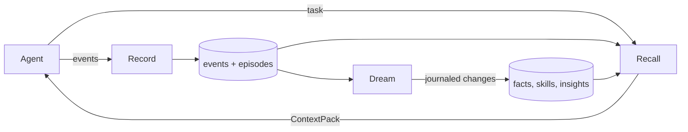

# Reverie

Reverie is a memory engine for AI agents, written in Go. An agent writes down what happens while it works. Reverie turns that record into facts, skills and summaries while the agent is idle, and hands the agent a short, cited block of relevant memory the next time it starts a task. The idea follows how sleep consolidates memory: the awake path is fast and dumb, and the thinking happens offline, on a budget, and can be undone.

It runs as a single binary with an embedded SQLite file by default, so there is nothing to set up. Postgres is available as a server backend.

> **Status:** v1 (M0–M5) and v1.1 (M6) are built. The code builds, vets and passes `go test -race ./...`. Treat it as pre-release: see [Known gaps](#known-gaps).

## Contents

- [What it does](#what-it-does)
- [Quick start](#quick-start)
- [Ways to connect an agent](#ways-to-connect-an-agent)
- [Core concepts](#core-concepts)
- [How a request flows](#how-a-request-flows)
- [Dreaming](#dreaming)
- [Safety model](#safety-model)
- [CLI reference](#cli-reference)
- [Configuration](#configuration)
- [Codebase map](#codebase-map)
- [Storage](#storage)
- [Testing and evals](#testing-and-evals)
- [Measured results](#measured-results)
- [Known gaps](#known-gaps)
- [Design principles for contributors](#design-principles-for-contributors)

## What it does

| Layer | What it holds | Written by | Read by |
| --- | --- | --- | --- |
| Events | Every message, tool call, decision and outcome, append-only | The agent, through an adapter | Dreams, `Expand` |
| Episodes | One task's events plus a title, outcome and importance | Recording, automatically | Recall |
| Facts | `entity relation value` triples with two clocks (when true, when learned) | The user, the agent, dreams | Recall |
| Skills | Versioned tool-sequence procedures (`candidate` → `active` → `deprecated`) | Dreams, promoted by real use | Recall |
| Insights | Speculative connections between distant memories | Dreams (opt-in) | Recall, only once confirmed |

Three operations make up the public API (`memory.go`):

- **`Record`** appends events. No model calls, so it costs milliseconds.
- **`Recall`** returns a `ContextPack` that fits a token budget you choose. Every item carries a citation.
- **`Expand`** returns the raw events behind any pack item, so a summary never hides its evidence.

`Remember`, `Forget`, `Pin` and `Revert` round out the fact lifecycle.

## Quick start

Requires Go 1.26 or newer.

```sh
git clone git@github.com:Dubjay18/reverie.git
cd reverie
go build -o reverie ./cmd/reverie

# Tell it something, in your own words (stored as user_stated, the most trusted source)
./reverie remember -project demo -text "I deploy with Vercel"

# See what it believes
./reverie facts -project demo

# Ask for memory relevant to a task
./reverie recall -project demo -task "deploy the frontend"
```

The database is created on first use at `$XDG_DATA_HOME/reverie/reverie.db` (usually `~/.local/share/reverie/reverie.db`) with mode `0600`. Override it with `-db` or `REVERIE_DB`. The default project is your current working directory.

Run a dream over recorded episodes:

```sh
export OPENAI_API_KEY=...        # Distill needs a model; without one the other phases still run
./reverie dream                  # consolidate, then print a one-line summary
./reverie journal                # every change, with run ids
./reverie dream show <run-id>    # a readable diff of one run
./reverie revert <run-id>        # undo a run
```

## Ways to connect an agent

All adapters call the same engine, so memory written through one is visible through the others when they use the same scope.

### Claude Code: hooks plus MCP

`reverie hook` reads a Claude Code hook payload on stdin and records it. It handles `SessionStart`, `UserPromptSubmit`, `PostToolUse`, `PostToolUseFailure`, `SessionEnd` and `Stop`, and injects a recall pack at session start. `reverie hook stop` starts a dream when there is unprocessed work. A hook never breaks the agent: errors go to stderr and the exit code stays 0.

```jsonc
// Claude Code settings: register `reverie hook` for each event you want recorded
{ "hooks": { "UserPromptSubmit": [{ "hooks": [{ "type": "command", "command": "reverie hook" }] }] } }
```

`reverie mcp` serves memory tools over MCP on stdio:

```jsonc
{ "mcpServers": { "reverie": { "command": "reverie", "args": ["mcp"] } } }
```

| MCP surface | Purpose |
| --- | --- |
| `memory_recall` | Cited memory for a task |
| `memory_record` | Record a decision, correction or note |
| `memory_remember` | State a fact (stored as `agent_stated`, never as the user's words) |
| `memory_forget` | Forget a fact by its `fact:<id>` ref |
| `memory_expand` | Raw events behind a ref |
| `memory_skill_outcome` | Report whether a recalled skill worked |
| Resource `memory://pack/current` | The pack for the current scope with no task, for clients that preload resources |

The hook payload fixtures in `testdata/hooks/` were written from the Claude Code documentation, not captured from a live session. The `Stop` and `SessionEnd` schemas in particular should be re-checked against a real session.

### HTTP API (any language)

```sh
./reverie serve -addr 127.0.0.1:8080
```

JSON endpoints under `/v1/`: `record`, `recall`, `expand`, `remember`, `forget`, `dream`, `revert`, `facts`, `journal`, `skills/outcome`, `healthz`. The OpenAPI 3.1 document is served at `/openapi.json` (source: `adapters/http/openapi.json`). `adapters/http/client.ts` is a thin TypeScript client. `GET /journal` is a read-only HTML page of recent dream runs and changes for one scope.

The server has no authentication. Bind it to loopback or put it behind something that authenticates.

### LLM proxy middleware (Go)

`adapters/proxy` is a standard `func(http.Handler) http.Handler`. Put it in front of an OpenAI-compatible `/chat/completions` or Anthropic `/messages` upstream. For each request it recalls memory for the latest user message, adds it to the system prompt inside a delimited block marked as data, forwards the request, streams the reply back unchanged, and records the turn. The scope comes from the `X-Reverie-Scope: tenant/agent/project/user` header (empty parts use the default) and is stripped before forwarding. If anything about memory fails, the request goes through untouched. It is a library: there is no `reverie` command that runs it yet.

### Go library

```go
eng, err := engine.Open("reverie.db", engine.WithLLM(model))
defer eng.Close()

sc := reverie.Scope{Tenant: "acme", Agent: "assistant", Project: "billing", User: "jay"}
eng.Record(ctx, reverie.NewEvent(sc, "task-1", reverie.Message, reverie.OriginUser, payload))
pack, _ := eng.Recall(ctx, sc, "fix the webhook retries", 1500)
fmt.Print(pack.Render())
```

`engine.New(store, opts...)` wraps any `store.Store`, which is how the Postgres backend is used.

## Core concepts

**Scope.** Every row belongs to a `(Tenant, Agent, Project, User)`. All four are required for writes. A scope is bound once when you ask the store for a handle, and no method accepts a scope after that, so a query cannot be written without one. Skills are the exception: they belong to a `(Tenant, Project)` and may be narrowed to one agent.

**Event origin.** Each event says who produced its content: `user_input`, `agent_decision`, `tool_output`, `system` or `recalled`. Dreams use it to decide what counts as evidence. Tool output alone never earns trust, and `recalled` memory is never evidence, because that would let memory reinforce itself.

**Fact trust order.** `user_stated` > `agent_stated` > `distilled` > `inferred`. A more trusted source wins a conflict. MCP and HTTP callers are always `agent_stated`, so an agent cannot mint or erase the user's own statements. Dreams may only produce `distilled` or `inferred` facts, and never change a `user_stated` or pinned fact.

**Bi-temporal facts.** A fact has a valid time (when it was true) and a recorded time (when Reverie learned it). Superseding a fact closes its valid time rather than deleting it; forgetting writes a tombstone. Nothing is hard-deleted, and `facts -asof <time>` shows what was believed then.

**Ontology.** `internal/ontology/default.yaml` lists the relations a fact may use, whether each holds one value or many, and an optional `ttl_days` after which an unrestated fact expires (`status` expires after 90 days). Replace it with `engine.WithOntology`.

**Journal.** Every change to long-term memory writes a journal row holding the before and after state. `revert <run-id>` plays a run backwards. A revert is itself a run, so it can be reverted.

**Citations.** Pack items look like `[ep:<task>#<from>..<to> @<time>]`, `[fact:<id> @<time>]`, `[skill:<id>@v<n>]` or `[insight:<id>]`. The first word is a valid ref for `Expand`.

## How a request flows



**Record** validates every event, then writes each scope's events in one transaction: append to the log and advance the episode row. Secrets are redacted on the way in. A `task.ended` event closes the episode and queues it for embedding. No model is involved.

**Recall** always combines two pools: recent unconsolidated episodes (so nothing is forgotten mid-session before a dream runs) and long-term memory. Long-term candidates come from three ranked lists (vector similarity, full-text, and entity matches expanded up to two hops) fused with reciprocal rank fusion. Recency and importance are applied afterwards as scores. The assembler gives each layer a share of the budget, spills unused share down, never exceeds the budget, and orders the result so the most important items sit at the start and end. An item that is too large is truncated with a marker and an `Expand` ref, never dropped silently.

**Expand** returns raw events for an episode or a ULID range, scope-checked and size-capped.

## Dreaming

A dream is a budgeted batch job. It takes a per-scope lease so two dreams never overlap, reads through a read-only view (phases cannot get a transaction), and collects proposals. Only then does one transaction commit everything the safety gate accepted, together with its journal rows and the episodes it consolidated. A crash before the commit writes nothing.

| Order | Phase | What it does | Needs a model |
| --- | --- | --- | --- |
| 1 | Replay | Picks unconsolidated episodes by importance and clusters them | No |
| 2 | Distill | Extracts structured facts, rewriting "yesterday" to absolute dates | Yes |
| 3 | Reconcile + Reflect | Checks each proposal against current facts; turns failed episodes into `lesson` facts | No |
| 4 | Synthesize | Clusters successful episodes by tool sequence and drafts `candidate` skills | No |
| 5 | Recombine | Pairs distant episodes that share an entity and drafts speculative insights. **Off by default** | Yes |
| 6 | Forget | Expires facts past their `ttl_days`, decays unused ones, compresses old episodes | No |
| 7 | Validate | The gate in `internal/guard`, run over every proposal from phases 1–6 before anything is written | No |

When the token budget runs low, Recombine is skipped first, then Distill. The gate and the deterministic phases always run.

Triggers: manual (`reverie dream`), pressure (5 or more unconsolidated episodes), idle (newest unconsolidated episode is 30 minutes old), `reverie hook stop`, and a 24-hour cron interval. Thresholds are in `internal/dream/triggers.go`.

### Skills

A skill is an ordered list of tool names that worked repeatedly for a kind of task. A dream only ever creates it as a `candidate`. Recall offers a candidate labelled "proposed method, unverified" and the outcome the agent reports is recorded against it (`reverie skill outcome`, `memory_skill_outcome`, `POST /v1/skills/outcome`).

- A candidate becomes `active` after 3 successes, provided its success rate is at least 0.5. The rate is the mean of Beta(successes+1, failures+1), so one lucky run does not look like certainty. Only one version of a skill is active at a time.
- An active skill is `deprecated` after 5 or more uses if its rate falls below 0.5.
- `reverie skill rollback <id>` withdraws the active version and restores the newest earlier proven one. It is journaled.

### Insights

Recombine output is speculative. Confidence is capped at 0.5, and an insight needs two distinct source episodes with real evidence. It stays out of Recall until a later, independent episode that mentions its entities confirms it, or you run `reverie insight confirm <id>`. It is always labelled "speculative insight, not a fact", and no code path ever turns an insight into a fact.

## Safety model

Everything in this layer is deterministic. There is no model acting as a judge.

1. **Mandatory origin.** Adapters set it. The hook drops or marks as `recalled` any event produced by Reverie's own tools (the bootstrap guard).
2. **Provenance required.** A dream proposal must cite at least one real episode, and recalled-only evidence does not count.
3. **No injected instructions or secrets.** Proposed text that matches instruction patterns or secret patterns is rejected, and a fact whose only evidence is tool output is held to a stricter version of the same rule.
4. **Confidence caps.** A single-episode `inferred` fact is capped at 0.6; insights at 0.5.
5. **Immutable user data.** Dreams never modify `user_stated` or pinned facts, even when the proposed value is equal.
6. **Hard token budget** per dream run.
7. **Redaction.** Secrets (API keys, bearer tokens, PEM blocks, passwords in URLs or env lines) are redacted before they reach the log, the index or `Expand`. `reverie scrub` cleans data stored before a rule existed.
8. **Scoping by construction**, plus Postgres row-level security as a second layer.
9. **Recalled facts are rendered as data**: values are quoted and length-capped, and anything not stated by the user is marked unverified. Episode error text is never rendered into a prompt.

The patterns are a floor, not a guarantee. If you find a bypass, treat it as a bug.

## CLI reference

```
reverie <command> [flags]
```

Most commands take `-db`, `-tenant`, `-agent`, `-project`, `-user`. Put flags before positional arguments.

| Command | Purpose |
| --- | --- |
| `record` | Append one event |
| `tail` | Print events, then follow new ones |
| `recall -task "..." -budget N` | Print the memory pack for a task |
| `expand <ref>` | Raw events behind a ref |
| `remember -text "..."` | State a fact as the user |
| `facts [-asof T] [-contested]` | List what is believed |
| `forget <fact:id>` / `pin` / `unpin` | Tombstone a fact, or protect it from dreams |
| `journal [-n N]` | Recent changes with run ids |
| `revert <run-id>` | Undo a run |
| `dream [-budget N]` / `dream show <run>` / `dream revert <run>` | Consolidate, inspect, undo |
| `skill list` / `skill outcome <ref> success\|failure` / `skill rollback <id>` | Procedural memory |
| `insight list` / `insight confirm <id>` / `insight reject <id>` | Speculative insights |
| `embed` | Embed waiting items (needs an embedder configured) |
| `scrub` | Redact secrets from earlier data |
| `hook [stop]` | Handle a Claude Code hook payload on stdin |
| `mcp` | MCP server on stdio |
| `serve [-addr A]` | HTTP API |

## Configuration

| Variable | Effect |
| --- | --- |
| `REVERIE_DB` | Database file path |
| `REVERIE_TENANT`, `REVERIE_AGENT`, `REVERIE_PROJECT`, `REVERIE_USER` | Default scope for hook, MCP, serve and the CLI commands that use it (defaults: `local`, `claude-code`, current directory, `$USER`) |
| `REVERIE_ADDR` | Listen address for `serve` (default `127.0.0.1:8080`) |
| `OPENAI_API_KEY` | Enables the Distill and Recombine model. Never commit one |
| `REVERIE_LLM_MODEL`, `REVERIE_LLM_BASE_URL` | Chat model (default `gpt-4o-mini`) and an OpenAI-compatible endpoint |
| `REVERIE_EMBEDDINGS=openai` | Turns on vector search (needs `OPENAI_API_KEY`; default model `text-embedding-3-small`, 1536 dimensions) |
| `REVERIE_RECOMBINE=1` | Enables the Recombine phase |

Without an embedder, search is full-text only and everything still works offline. The embedder's model and dimension are pinned in the database on first use; opening it with a different one fails rather than mixing incompatible vectors. Hooks never call a network embedder, to stay fast.

## Codebase map

```
reverie/
├── event.go  fact.go  ref.go  memory.go   Public types: Scope, Event, Origin, Fact, Ref, Memory, ContextPack
├── cmd/reverie/                           The CLI (main.go, adapters.go, procedural.go)
├── engine/                                The Memory implementation that wires store, recall, dreams
├── adapters/
│   ├── hook/                              Claude Code hook handler
│   ├── mcp/                               MCP server (hand-written JSON-RPC over stdio)
│   ├── http/                              JSON API, OpenAPI, journal page, TypeScript client
│   └── proxy/                             LLM proxy middleware
├── internal/
│   ├── store/                             Store, Scoped, Tx and the repo interfaces
│   │   ├── sqlite/                        Default backend (pure Go, FTS5, numbered SQL migrations)
│   │   ├── postgres/                      Server backend (tsvector, row-level security)
│   │   └── storetest/                     Conformance suite both backends must pass
│   ├── episodes/                          Builds episodes from events
│   ├── recall/                            Candidates → fuse → score → assemble (U-shaped)
│   ├── rank/                              Reciprocal rank fusion
│   ├── embed/                             Embedder interface and OpenAI client
│   ├── facts/                             Assert (pure), Remember, Forget, Pin, RevertRun
│   ├── ontology/                          Relation schema (default.yaml)
│   ├── dream/                             Run, budget, lease, phases, triggers
│   ├── skills/                            Skill lifecycle, Beta rate, tool-sequence clustering
│   ├── guard/                             The deterministic safety rules and redaction
│   ├── llm/                               LLM interface, deterministic Fake, OpenAI client
│   ├── telemetry/                         Spans and token metering (stdlib, OTLP-style JSON)
│   └── memstore/                          In-memory Memory for tests
├── evals/                                 Scenario runner, benchmark subsets, baselines, RESULTS.md
├── docs/                                  EVALS.md, PERF.md
└── testdata/hooks/                        Hook payload fixtures
```

Where to start reading:

| If you want to understand… | Read |
| --- | --- |
| The public contract | `memory.go`, `event.go`, `fact.go` |
| How storage is bounded by scope | `internal/store/store.go` |
| Recording and episodes | `engine/engine.go` (`Record`), `internal/episodes/builder.go` |
| Recall | `internal/recall/recall.go`, then `assemble.go` |
| Fact conflict rules | `internal/facts/assert.go`, then `service.go` |
| A dream, end to end | `internal/dream/run.go`, then `phase.go` and the phase files |
| The safety rules | `internal/guard/validate.go`, `procedural.go`, `secrets.go` |
| How revert works | `internal/facts/service.go` (`RevertRun`), `revert_procedural.go` |
| Skills | `internal/skills/skills.go`, `synthesize.go` |

## Storage

**SQLite (default).** One file in WAL mode with a single writer and concurrent read-only views. Typed tables (`events`, `episodes`, `facts`, `fact_sources`, `skills`, `insights`, `journal`, `dream_runs`, `dream_leases`) hold the truth. An `items` table with an FTS5 index and vectors stored as BLOBs is a derived retrieval index that can be rebuilt. Schema changes are numbered files in `internal/store/sqlite/migrations/`, applied automatically on open.

**Postgres.** The same interface and the same conformance suite, using `tsvector`/GIN for text and `BYTEA` unit vectors with exact cosine scoring (no pgvector). Every scoped table has row-level security enabled and forced, with each transaction naming its scope, so a query that forgot its filter sees nothing. Connect it in Go with `postgres.Open(ctx, dsn, cfg)` and `engine.New`; the CLI always uses SQLite.

Both backends scale to the sizes measured below. Vector search is a brute-force scan, which is the dominant cost; there is no vector index.

## Testing and evals

```sh
go build ./... && go vet ./... && go test -race -count=1 ./...
```

- **Postgres tests** start `postgres:16-alpine` through `docker run`, or use the database in `REVERIE_TEST_DSN`. They skip when neither is available, so run them with Docker before trusting the Postgres backend. The row-level-security test connects as an ordinary role, not a superuser.
- **Conformance suite** (`internal/store/storetest`) runs identically against SQLite and Postgres. Add a case there when you add a repo method.
- **Evals** (`evals/`) run five YAML scenarios (amnesia, contradiction, staleness, isolation, continuity) plus small LongMemEval and LoCoMo subsets through four configurations. Results are in `evals/RESULTS.md`; method and caveats are in `docs/EVALS.md`.
- **Performance** tests are opt-in: `REVERIE_PERF=1 go test -run TestLoad10KEpisodes5KFactsAndConflictScan -v ./internal/recall`. Numbers are in `docs/PERF.md`.
- A live OpenAI test exists and skips unless `REVERIE_TEST_OPENAI_KEY` is set.
- The `llm.Fake` model gives dream tests deterministic output, so no test needs a network.

## Measured results

From `evals/RESULTS.md` and `docs/PERF.md` (small fixtures, so read these as a sanity check, not a benchmark):

| Configuration | Queries | Accuracy |
| --- | ---: | ---: |
| No memory | 13 | 0.0% |
| Full context | 13 | 46.2% |
| Raw history search | 13 | 53.8% |
| Reverie | 13 | 92.3% |

The weakest category is LongMemEval temporal reasoning at 1 of 2: arithmetic across two separate episodes is not precomputed into a fact.

Recall at 10,000 embedded episodes and 5,000 facts: p50 228 ms, p95 250 ms against a 300 ms target. Earlier measurements on a busier machine reached 382 ms at the 10K-episode size, so treat the target as met on a quiet machine, not guaranteed.

## Known gaps

- The CLI has no Postgres option and no command that runs the proxy; both are used from Go.
- The TypeScript client has no skill-outcome or journal calls.
- A proxy request that a client retries is recorded twice.
- The HTTP server and journal page have no authentication.
- A draft skill is not dry-run against a held-out past episode before it is accepted.
- Hook payloads for `Stop` and `SessionEnd` are unverified against a live Claude Code session.
- Eval fixtures are small subsets, not full LongMemEval or LoCoMo runs.
- Vector search is a brute-force scan, with no approximate index.

## Design principles for contributors

- **Events are truth.** Episodes, facts, skills and the search index are projections that can be rebuilt.
- **Keep the write path dumb.** No model call may land on `Record`.
- **Dream phases only propose.** They get a read-only view and cannot write; the single commit is the only place state changes.
- **The gate always runs last** and always covers every proposal. Do not add a path around `internal/guard`.
- **Every change is journaled** with enough to undo it, and nothing is hard-deleted.
- **Scope is bound once**, in the store handle. Do not add a method that takes a scope.
- **Prove it by running it.** Add a test that fails without your change, and run the checks above before opening a pull request. Do not put real credentials in code, tests or fixtures; build token-shaped test values at runtime so secret scanners stay quiet.
